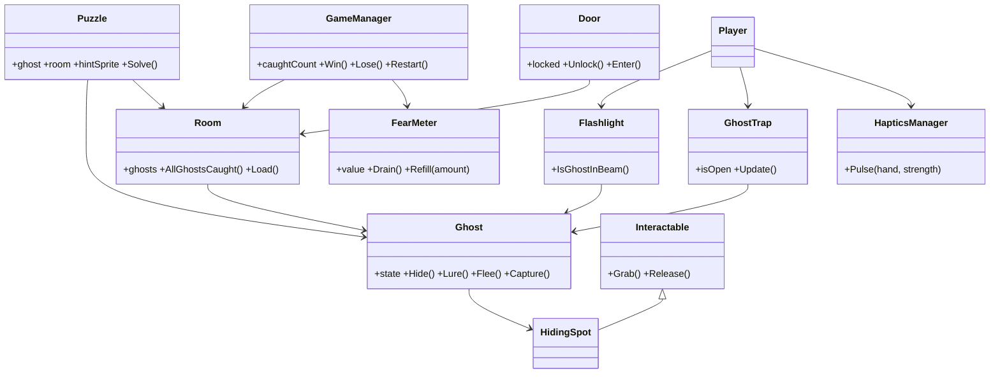

# Kamer vol spoken – Game Design (voor Claude Code)

Dit is de bron van waarheid voor wat we bouwen. Het volledige Design Document en het Projectdocument staan op de IDD-site; dit bestand is de samenvatting die Claude Code nodig heeft om te bouwen zonder te gokken. Bij twijfel: niet zelf bedenken, maar vragen. Verandert het ontwerp, dan wordt dit bestand eerst aangepast.

## 1. In één alinea

Een korte, grappige maar spannende VR-game voor de **Meta Quest 3 (standalone)**. De speler is de nieuwe huisbewaarder van een oud huis bij nacht en moet het "leegmaken": de spoken die er wonen, willen vooral gevonden worden. Je **hoort** een spook (ruimtelijk geluid), **zoekt** het met je zaklamp, **lokt** het uit zijn verstopplek met een kleine puzzel en **vangt** het met zaklamp en spookval. Zijn alle spoken van een kamer gevangen, dan gaat de pikzwarte deur open naar de volgende ruimte. Geen jumpscares: de spanning komt uit geluid, donker en onzekerheid. Toon: joke-horror, grappig, nooit eng.

## 2. Kernloop

`Luister → Zoek → Lok → Vang → herhaal`, tot alle spoken van het huis gevangen zijn. Ondertussen loopt de **moed-meter** leeg als je in gevaar bent.

1. **Luister:** een verstopt spook maakt geluid (gekraak, gefluister, gelach) vanuit zijn verstopplek. Spatial audio vertelt de richting en afstand.
2. **Zoek:** de speler gaat naar het geluid en zoekt met de zaklamp, achter deuren en in lades. Raakt de bundel een verstopt spook, dan verschijnt een **gedachtebel** met een plaatje van wat het spook wil (geen tekst).
3. **Lok:** de speler lost de kleine puzzel van dat spook op. Dan komt het spook tevoorschijn.
4. **Vang:** bundel op het spook en de spookval open erbij, **2 seconden** vast. Het spook wordt in de val gezogen en er verschijnt **"Gevangen!"**. Verliest de speler de bundel, dan **vlucht** het spook en verstopt het zich opnieuw.

**Win:** alle spoken gevangen. **Verlies:** moed-meter leeg. Beide hebben een eindscherm.

## 3. Spoken en hun puzzels

Alle spoken delen een basismodel en gedrag; ze verschillen in uiterlijk, geluid en puzzel.

| Spook | Uiterlijk | Puzzel (lokken) | Kamer | Prio |
| --- | --- | --- | --- | --- |
| Boe | klein, rond, simpel gezicht | speelgoedbeer uit de lade halen en voor hem neerleggen | Woonkamer | Must |
| Giechel | groen, breed gezicht | het licht aandoen (in het donker durft hij niet te lachen) | Woonkamer | Must |
| Laken | klassiek spook onder een laken | het laken van hem afhalen met je handen | Slaapkamer | Must |
| Fluisteraar | klein, grijsblauw, zwarte ogen | de radio uitzetten die hem overstemt | Slaapkamer | Must |
| Rommelaar | simpel spook met handen | de gevallen vaas terugzetten op de kast | Slaapkamer | Could |
| De Bewoner | één realistisch, donker spook, verschijnt nooit plotseling | familiefoto terugbrengen en de kaars aansteken | Zolder | Could |

**Drie puzzeltypes, hergebruikt voor alle spoken:**
1. een voorwerp **brengen** (naar de *geefzone* bij het spook: erbij houden of erin laten vallen);
2. iets **openen of weghalen** (lade, laken);
3. iets **aan- of uitzetten** (licht, radio, kaars).

**Regels voor elke puzzel:** maximaal 2 stappen; alles ligt in dezelfde kamer; de hint is een plaatje; een puzzel kan niet mislukken (een weggegooid voorwerp ligt na een paar seconden weer op zijn plek); de speler hoeft nooit tekst te lezen.

## 4. Spelsystemen (wat er gebouwd moet worden)

### 4.1 Spookgedrag (state machine)
Toestanden: `Hidden → Lured → InBeam → Caught`, met `Fleeing` als uitweg uit `InBeam`.
- `Hidden`: zit in een `HidingSpot`, maakt geluid, is onzichtbaar/onbereikbaar tot de puzzel is opgelost.
- `Lured`: puzzel opgelost, spook komt tevoorschijn.
- `InBeam`: de lichtbundel raakt het spook; de vangtimer loopt. Spook licht op en maakt een geluidje (feedback voor de speler).
- `Caught`: timer vol met open spookval erbij; zuig-sequentie, "Gevangen!", teller +1.
- `Fleeing`: bundel verloren; spook rent weg (vluchtsnelheid, zie 4.8) naar een `HidingSpot` en wordt weer `Hidden`.

### 4.2 Zaklamp en lichtbundel
Zaklamp pakken en richten met één hand (twee handen als *Should*). Detectie met een **kegel** (bundelhoek, afstand en zichtlijn: geen muur ertussen). De moed-meter zit **op de zaklamp**, zodat hij altijd in beeld is.

### 4.3 Spookval (`GhostTrap`)
Lantaarn of pot. Alleen als de val **open** is en de bundel op het spook staat, loopt de vangtimer (2 s). De timer reset zodra de bundel wegvalt. Bij 2 s: zuig-VFX, spook krimpt in de val, "Gevangen!" + geluid + haptiek in beide controllers.

### 4.4 Riem
Zaklamp en spookval hangen aan een riem om het middel (zoals in Phasmophobia). Pakken met de hand van de heup, terugsteken door ze bij de holster los te laten. Laat de speler ze vallen, dan keren ze terug naar de riem. Handen blijven vrij voor deuren, lades en puzzels.

### 4.5 Deuren en ruimtes
Elke deur is pikzwart en **op slot** tot alle spoken van de kamer gevangen zijn. Daarna kan de speler erdoorheen **lopen, erin teleporteren of erop klikken**; pas dan laadt de volgende ruimte (de zwarte deur verbergt het laden). Een kleine **gang** is de hub, met een deur naar elke kamer. De zolderdeur blijft dicht zolang de zolder niet bestaat (Could). Bij voorkeur laadt steeds één ruimte tegelijk (prestaties).

### 4.6 Moed-meter
Loopt leeg als een spook dichtbij is **en** de speler de andere kant op kijkt. Vult +15% bij een gevangen spook. Leeg = verlies. De meter staat los van de vangloop en loopt dus door tijdens het zoeken. (De naam "moed-meter" is een werknaam.)

### 4.7 Horloge en haptiek
Horloge aan de **linkerpols** met een rij spook-icoontjes (per vangst gevuld) en "Kamer x van y". De **linker controller** trilt zachtjes als een spook dichtbij is, harder naarmate het dichterbij komt. Beide controllers trillen kort bij een vangst. Ook haptiek bij pakken en richten. Alle haptiek loopt via één `HapticsManager`.

### 4.8 Startwaarden (één moeilijkheidsgraad, alles instelbaar)
Zet deze als `ScriptableObject` (`GameSettings`) zodat ze zonder code aan te passen zijn. Ze worden bijgesteld na playtests.

| Instelling | Startwaarde |
| --- | --- |
| Meter loopt leeg (alleen bij gevaar) | na ca. 50 s |
| Meter vult bij gevangen spook | +15% |
| Vangtijd (bundel en val bij spook) | 2 s |
| Breedte lichtbundel | 25° |
| Vluchtsnelheid spook | 2,5 m/s |
| Hint als de speler vastzit | na 60 s |
| Weggegooid voorwerp terug na | enkele seconden (nader te bepalen) |

### 4.9 Hint
Zit de speler 60 seconden vast, dan roept het spook vaker en harder (binnen het volumeplafond). Geen tekst, geen pijlen.

### 4.10 Reacties op de zaklamp (Could)
Elk spooktype een eigen grappige reactie (Boe schaamt zich en kleurt rood, Giechel giechelt harder, Laken trilt onder zijn laken). Eerst alleen het basis-oplichten.

## 5. VR-basis (eisen van de opdracht, gelden altijd)

- **Tracking:** headtracking op schaal 1:1, vloer op vloerhoogte; beide controllers zichtbaar (handen of controllers). Zittend én staand speelbaar.
- **Interactie:** pakken, vasthouden, loslaten, gooien van **5+ soorten** objecten met physics.
- **Beweging:** teleport (standaard), snap turn, vloeiend lopen als optie met **vignet**. Nooit een gedwongen camerabeweging.
- **UI in de wereld:** startmenu, pauzemenu en één paneel in de game. Alle UI hangt als paneel in de wereld, wordt bediend met een controller-ray en beweegt niet mee met het hoofd.
- **Feedback:** haptiek bij pakken en richten; spatial audio voor 3+ events.
- **Comfort (eigen keuzes):** geen jumpscares, geen camerarasting, volumeplafond, drie playtests (waaronder iemand die snel misselijk wordt).
- **Techniek:** werkende APK op Quest 3, standalone, getest door een ander team.
- **Quest 3S:** we mikken er ook op dat dezelfde build goed draait op de Quest 3S (zelfde Android-build, minder zichtbare pixels). Bouw daarom met ruimte over: houd een marge onder het framebudget en test op de 3S zodra er een beschikbaar is. Maak geen aparte versie, wel instelbare kwaliteit (bijvoorbeeld renderschaal) waar dat nodig is.

### Techniek: Unity 6.3 en XR Interaction Toolkit

We volgen het Unity Learn VR Development pathway (Unity 6.3), dus gebruiken we de componenten uit het pathway:
- **XR Grab Interactable** voor voorwerpen (pakken, vasthouden, gooien met physics);
- **Socket Interactor** voor de holsters van de riem (zaklamp, spookval) en de geefzone bij een spook;
- **Activation events** op de zaklamp (trekker aan/uit, lichtbundel);
- **Near-Far en Ray Interactor** voor deuren, lades en klikken op de zwarte deur;
- **world-space UI** voor menu's, horloge en gedachtebel;
- teleport en snap turn via de locomotion-componenten van het pathway, met vignet als comfort.
Waar een eigen script nodig is (spookval, deurslot, puzzels), bouw je het als **custom interactable** zoals in missie 4 van het pathway.

## 6. Ruimtes

| Ruimte | Thema | Spoken | Opmerking |
| --- | --- | --- | --- |
| Kamer 1 | Woonkamer | Boe, Giechel | vertical slice; kleinste kamer, eenvoudigste zichtlijnen |
| Gang | hub | – | klein, bijna leeg, zwarte deur naar elke kamer |
| Kamer 2 | Slaapkamer | Laken, Fluisteraar (Could: Rommelaar) | meer verstopplekken: bed, kast, ladekast |
| Kamer 3 (Could) | Zolder | De Bewoner | laatste en spannendste kamer |

Kamers worden gebouwd met een **modulaire kit** (muren recht/hoek/deurgat/raamgat, vloer, plafond, plint). `HidingSpot`s en puzzelvoorwerpen zijn **data per kamer** zodat de designer ze kan aanpassen zonder code.

## 7. Klassen (eerste opzet, mag veranderen)

Uitgangspunten: `FearMeter` los van de vangloop; `HidingSpot` erft van `Interactable` (één keer interactie programmeren); de drie puzzeltypes zijn variaties van één `Puzzle`-klasse; haptiek op één plek in `HapticsManager`.

## 8. Schermen (UI)

Startmenu (Spelen, Comfort-instellingen, Stoppen), pauzemenu (hervatten, instellingen, naar hoofdmenu), comfort-instellingen (teleport of vloeiend, snap turn, zittend of staand), in-game weergave (meter op zaklamp + horloge), gedachtebel (plaatje, geen tekst), "Gevangen!"-bericht, eindscherm (winst of verlies, opnieuw spelen, naar hoofdmenu). Stijl: simpel, rustig, donker, weinig tekst. Lettertypen: Cinzel (koppen), Nunito (tekst).

## 9. Geluid, licht en art (voor de script-kant)

- Elk spook heeft een **eigen roep** (herkenbaar), als ruimtelijke bron met afstandsdemping. Ambient per kamer licht verschillend.
- Volumeplafond; nooit een harde piek.
- Look: low- tot mid-poly, flat colors met lichte textuur (hier en daar normal map), joke-game. Elke kamer een eigen kleurpalet (woonkamer bordeaux/hout met mosgroen en mosterd; slaapkamer blauw-paars met oranje lamplicht; zolder bruin en stofgrijs). Gedeeld: spookwit/spookgroen, geel zaklamplicht, blauw maanlicht, rood voor gevaar.
- Licht en effecten: Quest 3 (en 3S) is standalone, dus **baked licht** waar het kan, weinig realtime lichten, geen zware volumetrics (lichtbundel = simpele kegel).

## 10. Prioriteit (MoSCoW) en scope

- **Must:** 2 kamers (woonkamer, slaapkamer) + gang, 4 spoken met puzzel, zaklamp, spookval, riem, meter, horloge met haptiek, spatial audio, pikzwarte deuren, menu's en eindscherm, alle VR-basis, comfort.
- **Should:** gang als hub met schakelaar, tweehands-richten, weggegooide voorwerpen die terugkomen, spanning die oploopt, Play-Expo-vriendelijk starten.
- **Could (pas na de vertical slice):** zolder met De Bewoner, Rommelaar, zaklamp-reacties per spooktype, moeilijkheidsgraden, uv-lamp, stem-nadoend spook.
- **Won't:** multiplayer, jumpscares, geweld, PC-versie, savegames (de voortgang opslaan; comfort-instellingen onthouden mag wel), meer kamers dan woonkamer, slaapkamer, gang en (als Could) de zolder.

Eerst álle Musts, dan Shoulds; een Could pas als alle Musts én Shoulds af zijn.

## 11. Verantwoordelijkheden en wat Claude Code **niet** bouwt

- **Daniël** bouwt zelf: `LightSwitch`, `GiechelPuzzle` en het gedrag van het spook Giechel. Claude Code maakt hiervoor alleen een leeg bestand met TODO's, en legt op verzoek uit hoe de `Puzzle`-basisklasse werkt in plaats van de oplossing te schrijven.
- **Viktor** is de allrounder: backend-systemen, VFX (Unity VFX/Shader Graph), bugfixes en wat er verder tussendoor komt. Hij pakt losse taken op in elke lijst. Claude Code raakt de VFX-assets niet aan en laat bugfixes in code die Viktor net heeft aangepast aan hem, tenzij hij erom vraagt.
- **Artist-werk** (modellen, texturen, geluid) komt van de ontwerpers; Claude Code gebruikt placeholders (kubussen, capsules, stille geluidsbestanden) tot de echte assets er zijn.

## 12. Hoe Claude Code hier werkt

- Bouw per kleine, afgebakende taak uit de Trello-lijst **Scripts** (zie `PROJECT_PLAN.md` voor de volgorde en klaar-criteria per sprint).
- Eén branch per taak. Test op de Quest 3 voordat iets klaar is; "werkt in de editor" telt niet.
- Houd scripts klein en leesbaar; de studenten moeten ze kunnen begrijpen. Zet waarden in `GameSettings`, geen magische getallen.
- Geen `Find`/`GetComponent` in `Update`; geen geheugenallocaties per frame (Quest 3).
- Leg na elke taak in 3 tot 5 zinnen in het Nederlands uit wat je gebouwd hebt en hoe je het test.
- Wijkt iets af van dit ontwerp, of is iets onduidelijk? Vraag het, pas dit bestand aan, bouw daarna pas verder.
