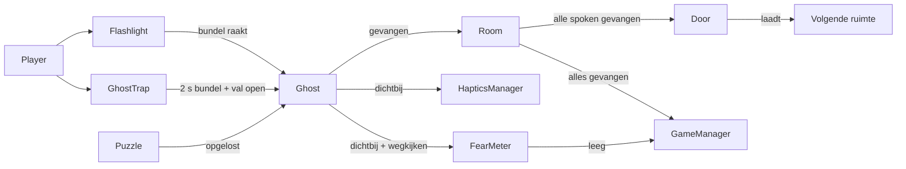

# Hoe Kamer vol spoken in elkaar zit (en hoe je iets verandert)

Voor het hele team (ontwerpers en technici). Dit is een **voorstel voor de indeling**; zodra het Unity-project er staat, past Claude Code dit bestand aan op wat er echt is. Verander je iets aan de structuur, pas dit bestand dan ook aan.

Eerst lezen: `GAME_DESIGN.md` (wat het spel doet) en `PROJECT_PLAN.md` (wanneer). Dit bestand zegt **waar het in het project staat** en **hoe je het aanpast**.

## 1. Mappen in Unity

Alles van ons staat onder één map, zodat het niet door de standaardbestanden van Unity heen loopt.

```
Assets/_Project/
  Scenes/        Hoofdmenu, Gang, Woonkamer, Slaapkamer (Zolder later)
    Test/        Testscenes T00–T13 per VR-techniek (zie TEST_SCENES.md), niet in de releasebuild
  Scripts/
    Core/        GameManager, GameSettings, FearMeter
    Player/      ComfortSettings, Flashlight, GhostTrap, Belt, HapticsManager
    Ghosts/      Ghost, GhostData, HidingSpot
    Puzzles/     Puzzle (basis), BringPuzzle, OpenRemovePuzzle, TogglePuzzle, GiveZone
    World/       Room, Door, Interactable, LightSwitch (Daniël)
    UI/          Menu's, ComfortMenu, Watch, ThoughtBubble, CaughtMessage
  Data/          GameSettings.asset, een GhostData per spook
  Prefabs/       Player (de VR-speler), Spoken, Props, Deuren, UI-panelen (InfoPanel, ComfortPanel), Zaklamp, Spookval
  Art/           Models, Materials, Textures, Palette
  Audio/         Roep per spook, Ambient per kamer, SFX, UI
  VFX/           Zuig-effect, Gevangen!, Zwarte deur (Viktor)
```

De VR-speler komt uit de XRI Starter Assets (in `Assets/Samples/XR Interaction Toolkit/3.3.2/`; daar niets aan veranderen). `Prefabs/Player.prefab` is een variant van `XR Origin (XR Rig)` met het vignet en `ComfortSettings` erbij. Wil je de speler aanpassen, doe het dan in die variant, niet in het sample.

## 2. Hoe de onderdelen samenwerken



In woorden: de speler richt de **zaklamp** op een **spook** en houdt de **spookval** open. Is een spook 2 seconden in de bundel, dan gaat het in de val (**Gevangen!**) en telt de **Room** het mee. Zijn alle spoken van de kamer gevangen, dan opent de **Door**. Een spook komt pas tevoorschijn als de **Puzzle** is opgelost. De **FearMeter** loopt los daarvan leeg; is hij leeg, dan verliest de **GameManager** het spel.

## 3. Waar staat wat?

| Onderdeel | Script | Waar zie je het in Unity | Wie past het meestal aan |
| --- | --- | --- | --- |
| Spelstand, win en verlies | `GameManager` | leeg object in elke scene | technicus |
| Alle instelbare getallen | `GameSettings` | `Data/GameSettings.asset` | ontwerper |
| VR-speler (teleport, snap turn, vloeiend lopen, vignet) | `ComfortSettings` op de `Player` | `Prefabs/Player.prefab` | technicus |
| Comfort-schakelaars | `ComfortMenu` | prefab `UI/ComfortPanel` | technicus + artist |
| Uitlegpaneel van een testscene | (geen script; tekst in de prefab) | prefab `UI/InfoPanel` | iedereen |
| Moed-meter | `FearMeter` | op de zaklamp-prefab | technicus |
| Zaklamp en lichtbundel | `Flashlight` | prefab `Zaklamp` | technicus + artist |
| Spookval en "Gevangen!" | `GhostTrap` | prefab `Spookval` | technicus |
| Riem met holsters | `Belt` (met Socket Interactors) | aan de speler, op middelhoogte | technicus |
| Spook | `Ghost` + `GhostData` | prefab per spook | ontwerper (data), technicus (gedrag) |
| Verstopplek | `HidingSpot` | op kast, lade, bank, bed | ontwerper |
| Puzzel | `BringPuzzle`, `OpenRemovePuzzle` of `TogglePuzzle` | op de props in de kamer | ontwerper + technicus |
| Kamer | `Room` | root van elke kamer-scene | ontwerper |
| Zwarte deur | `Door` | prefab `ZwarteDeur` | technicus + artist |
| Trillingen | `HapticsManager` | leeg object in de speler | technicus |
| Menu's, horloge, gedachtebel | scripts in `UI/` | world-space panelen | artist + technicus |

## 4. Zo verander je iets

### Een getal aanpassen (meter, vangtijd, bundelhoek, vluchtsnelheid, hint)
Open `Data/GameSettings.asset` en pas het getal aan. Geen code nodig. Alle scripts lezen hun waarde hier; staat een getal ergens anders hard in de code, dan is dat een fout: laat het aan Claude Code of een technicus corrigeren.

### Een spook toevoegen of veranderen
1. Maak een **GhostData** aan (Create → Spookhuis → Ghost Data): naam, prefab, roep (audio), plaatje voor de gedachtebel, puzzel en kamer.
2. Maak of kopieer een spook-prefab (basis `Ghost` + model) en koppel het aan de GhostData.
3. Zet het spook in de kamer en kies de `HidingSpot` waar het zich verstopt.
4. Voeg het spook toe aan de lijst in `Room`, zodat de deur het meetelt.
Een bestaand spook aanpassen (uiterlijk, roep, puzzel) doe je alleen in zijn GhostData en prefab.

### Een puzzel maken of veranderen
Kies het type: **brengen** (voorwerp naar de geefzone), **openen of weghalen** (lade, laken) of **aan- of uitzetten** (licht, radio). Zet het juiste script op het prop, koppel het aan het spook en kies het plaatje voor de gedachtebel. Houd de regels aan: maximaal twee stappen, alles in dezelfde kamer, geen tekst, kan niet mislukken.

### Een verstopplek toevoegen
Zet `HidingSpot` op een object (kast, lade, onder het bed) en sleep het in de lijst van het spook. Zorg dat de plek in de zichtlijn van de speler blijft.

### Een kamer of deur toevoegen
Maak een nieuwe scene met een `Room`, koppel zijn spoken en zet een `Door` naar de gang. De `Door` is op slot tot `Room` meldt dat alle spoken gevangen zijn. Zet de scene in de Build Settings, anders laadt de deur hem niet.

### UI veranderen
Panelen zijn world-space en staan als prefab in `Prefabs/UI`. Tekst en plaatjes pas je in de prefab aan. De kleuren komen uit `Art/Palette` (donker, rustig, weinig tekst). Zet nooit een scherm vast aan het hoofd van de speler.

### Geluid, VFX en kleuren
- **Geluid:** de roep van een spook staat in zijn GhostData; ambient hoort bij de kamer. Houd alles onder het volumeplafond.
- **VFX:** zuig-effect, "Gevangen!" en de zwarte deur zitten in `VFX/` (Viktor).
- **Kleuren:** palet per kamer staat in `Art/Palette`.

## 5. Waar het pathway bij hoort

| Wil je ... | Dan helpt les ... van het Unity VR-pathway |
| --- | --- |
| pakken, gooien en holsters | 1.3 Grabbable GameObjects en 1.4 Sockets |
| bewegen (teleport, snap turn) | 1.2 VR Locomotion |
| comfort-instellingen | 3.1 Comfort and Accessibility (fade en instellingenpaneel). Het vignet zit niet in de lessen: gebruik de Tunneling Vignette uit de XRI Starter Assets |
| zaklamp aan/uit en haptiek | 2.1 Audio and Haptics en 2.2 Activation events (de zaklamp zelf staat in de extensies van 2.2) |
| op afstand pakken en klikken (zwarte deur, menu's) | 2.3 Near-Far and Ray Interactors (kastdeuren staan in een extensie; lades voegen we zelf toe) |
| menu's | 2.4 User Interface (het horloge aan de pols zit niet in de les; dat voegen we zelf toe) |
| prestaties en licht | 3.2 Optimization en 3.3 Lighting |
| de game op de Quest zetten | 1.1 VR Project Setup (Build and Run) en 3.4 Building and Sharing (build profiles, versie) |
| een eigen interactable (spookval, deurslot, LightSwitch) | missie 4 (Custom VR Development) |

## 6. Wil je het ontwerp zelf veranderen?

1. Bedenk wat je wilt en waarom, en bespreek het in de groep.
2. Pas eerst `GAME_DESIGN.md` aan, dan pas de code.
3. Zet de taak op Trello (lijst Scripts, Assets, UI of VFX) met een prioriteit: Must, Should of Could.
4. Test op de Quest 3 voordat je zegt dat het klaar is.

Past het niet binnen de planning of binnen de Musts, dan wordt het een Could. Een Could pak je pas op als alle Musts en Shoulds af zijn.
